# Solar Odyssey

宇宙船で太陽系を旅しながら学べる、教育用の3Dウェブアプリです。

**▶ ブラウザですぐ遊べます： https://junzzy827.github.io/solar-odyssey/**
（インストール不要・無料。PC とスマホ・タブレットに対応）

[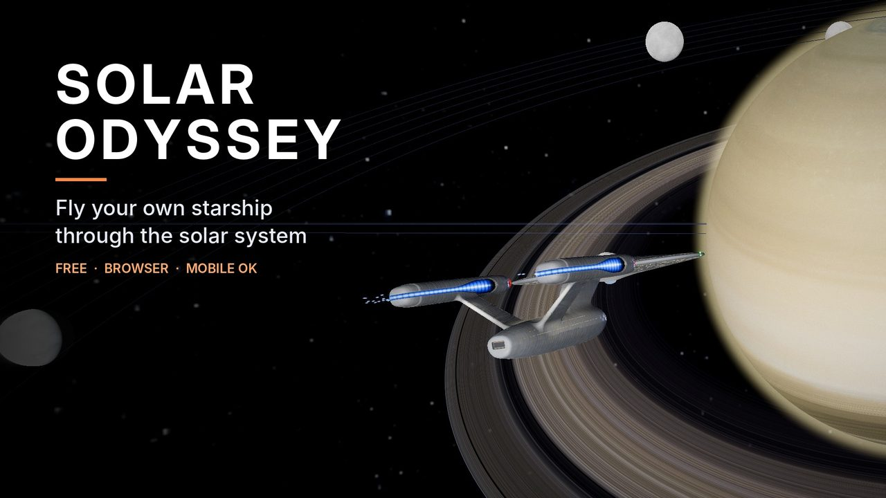](https://junzzy827.github.io/solar-odyssey/)

## スクリーンショット

### 太陽系を旅する

| | |
| --- | --- |
| 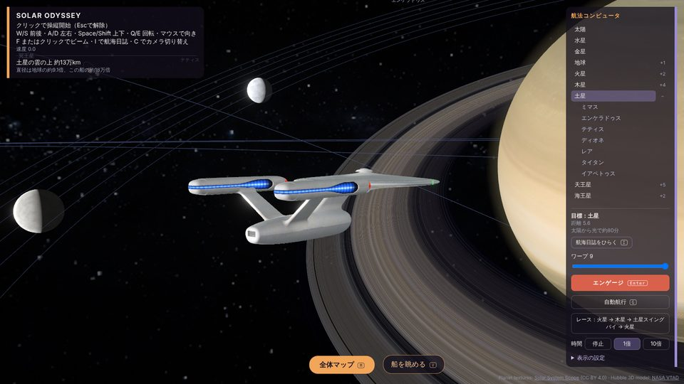 | 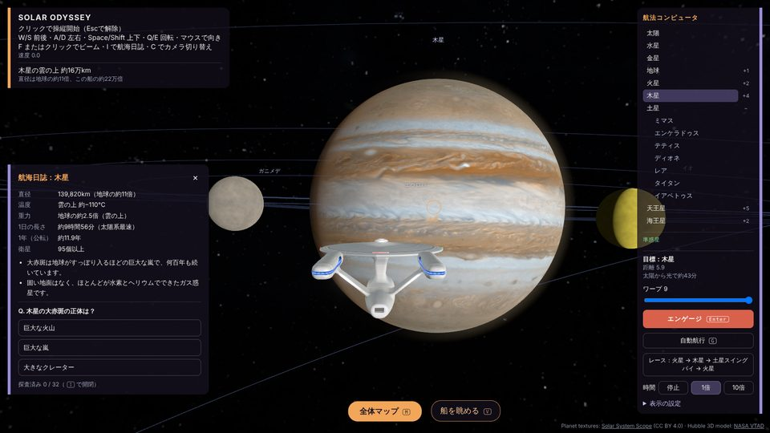 |
| 惑星や衛星へワープして、自由に飛び回れます | 着いた天体の航海日誌を読んで、クイズに挑戦 |
| 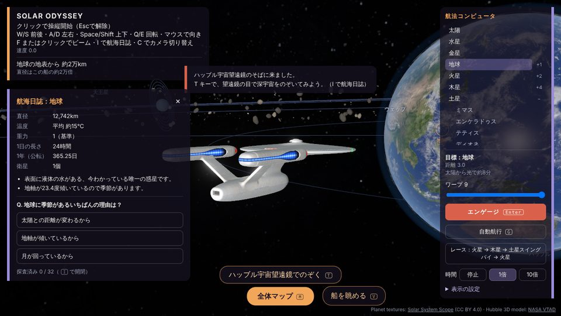 | 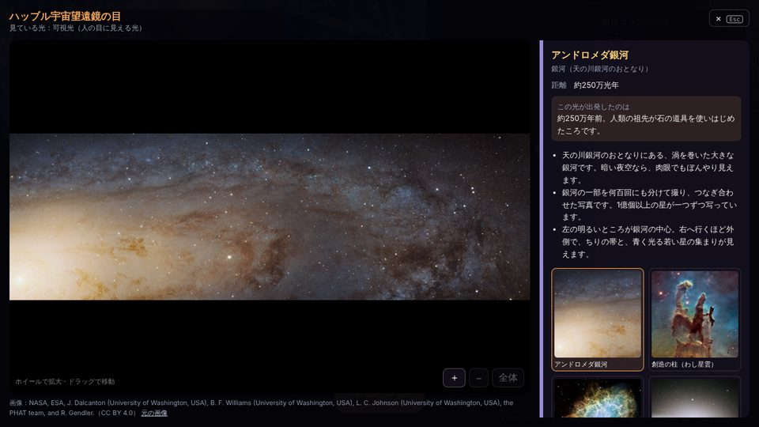 |
| 実際のデータをもとにした天体の解説 | 望遠鏡モードでハッブルの画像を見られます |

### 宇宙船と艦橋

| | |
| --- | --- |
| 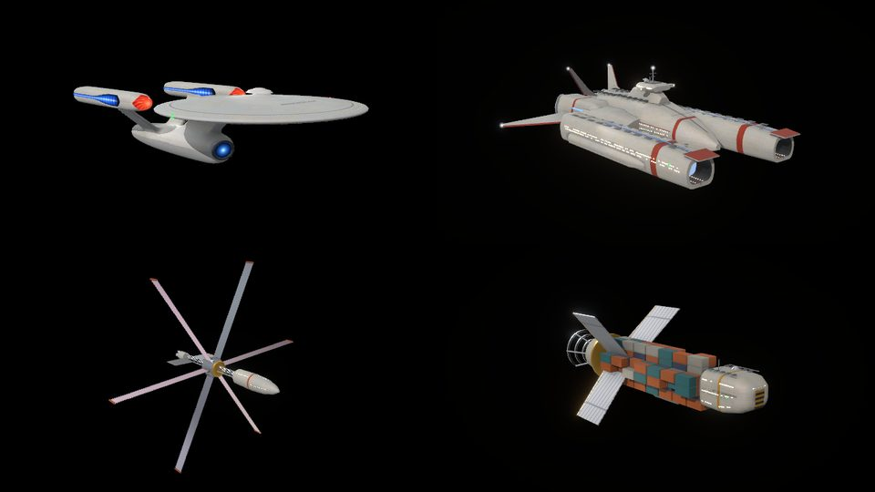 | 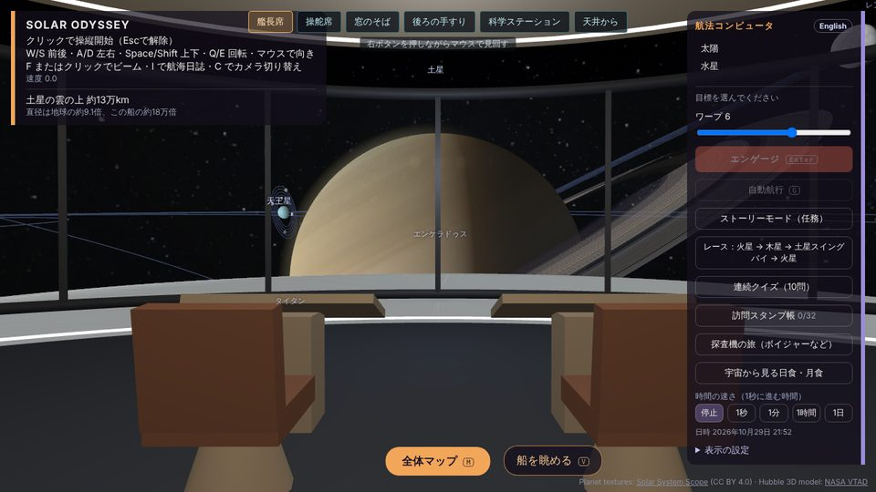 |
| 6隻のオリジナル宇宙船から選べます | 艦橋に入って窓から景色を眺められます |

### SFモード

| | |
| --- | --- |
| 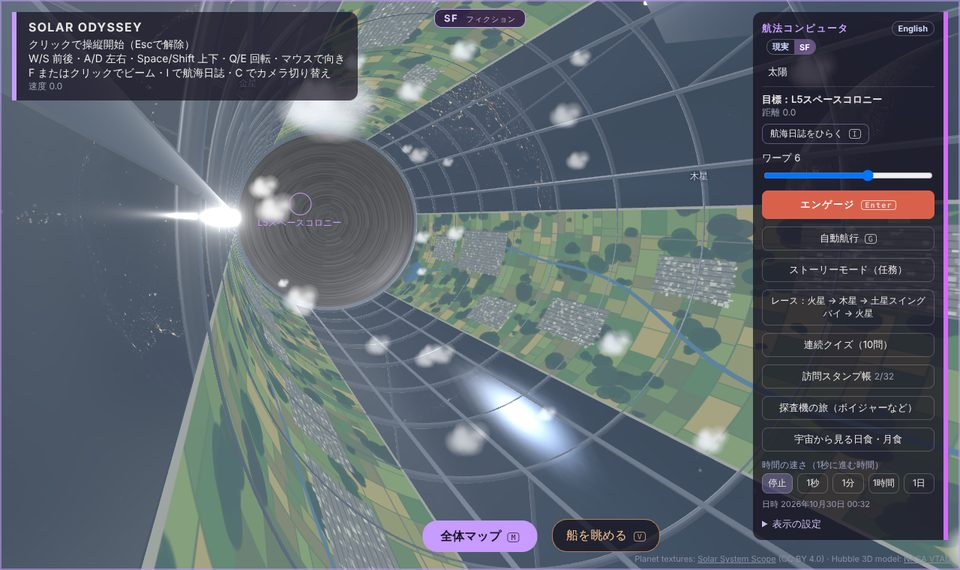 | 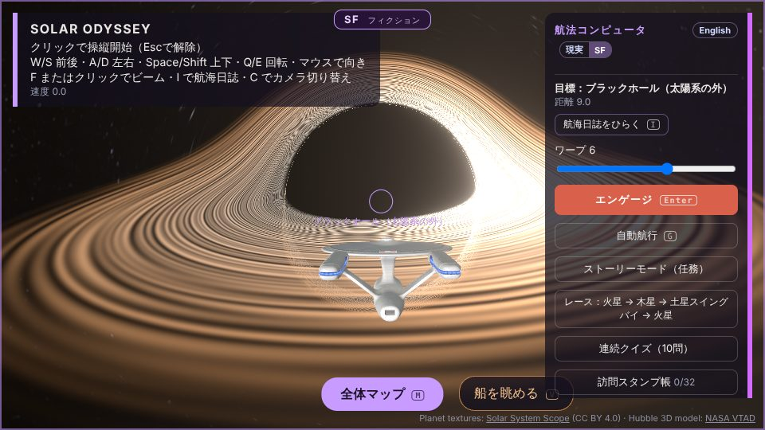 |
| 回転する円筒型スペースコロニー | 太陽系の外にあるブラックホール |
| 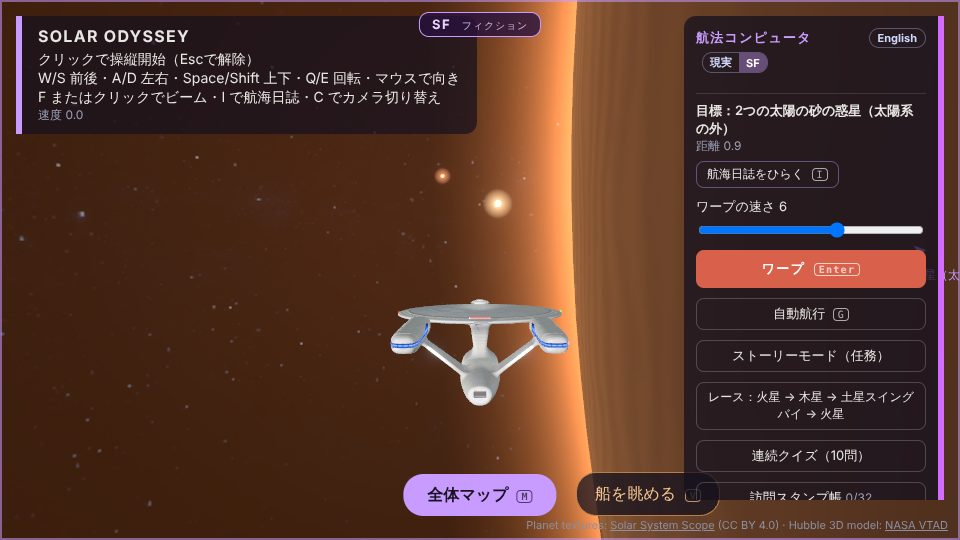 | 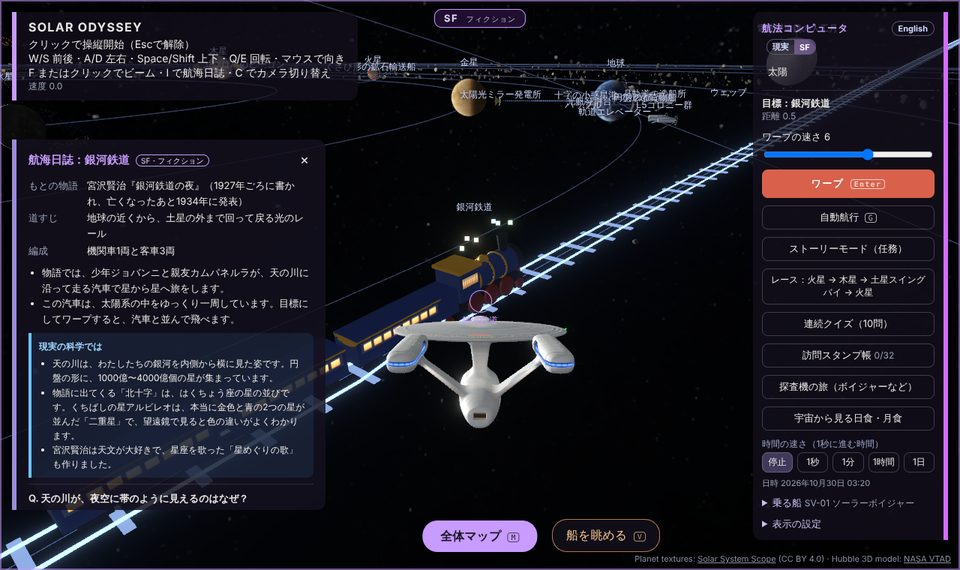 |
| 2つの太陽が沈む砂の惑星 | 宇宙空間を走る銀河鉄道 |

### スマホでも

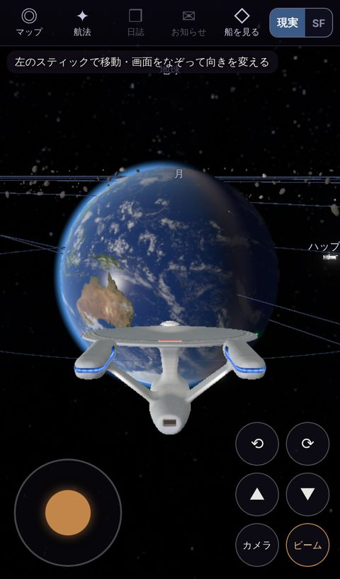

## 開発

```bash
npm install
npm run dev      # http://localhost:5173
npm run build    # dist/ に出力
```

## 操作

| 操作 | キー |
| --- | --- |
| 全体マップ／操縦席の切り替え | M |
| 操縦開始（マウス固定）／解除 | 画面クリック／Esc |
| 前後・左右・上下 | W/S・A/D・Space/Shift |
| 向き・ロール | マウス・Q/E |
| 目標設定 | 右の航法コンピュータ、またはマップ上の名前をクリック |
| ワープ速度 | 1〜9 |
| ワープ | Enter |
| 自動航行 | G |
| 船を眺める（鑑賞モード） | V |

スマホ・タブレットでは、左下のスティックで移動、画面をなぞって向きを変え、右下のボタンで上昇・下降・回転・ビームを使います。

## 構成

- Vite + TypeScript + React Three Fiber（Three.js）
- `src/data/bodies.ts` 天体データ（NASA Planetary Fact Sheet の概数）
- `src/data/scale.ts` 表示スケール。距離は対数で圧縮し、惑星は同じ平面上の同心円で公転する
- `public/models/ship-hull.glb` 自機の機関部（首・副船体・パイロン・ナセル）。`tools/blender/build_hull.py` で生成する
  （Blender の Python モジュールを使う。`pip install bpy scikit-image` した Python 3.13 で実行）。
  `#hangar` を付けて開くと自機だけを眺められる（`#hangar?cam=x,y,z&target=x,y,z&fov=n` で視点を固定）

## 公開

`main` へのpushで GitHub Actions が GitHub Pages にデプロイします。
初回のみ、リポジトリの Settings → Pages → Source を「GitHub Actions」にしてください。

## 版権について

特定の作品の名称・ロゴ・設定画・音声は使わず、宇宙船や画面デザインはオリジナルで制作します。
BGM（`public/music/`）もこのアプリのために作ったオリジナル曲で、`tools/music/bgm.py` でシンセ合成しています。
