# Solar Odyssey

**English** | [日本語](README.ja.md)

A free 3D web app for exploring the Solar System aboard your own starship. Fly between planets and moons, read the ship's log about each world, take quizzes, land and drive a rover on real terrain, and switch to SF mode for space colonies, black holes and a railway among the stars.

It started as a learning toy made for a 10-year-old, and it keeps growing.

**▶ Play in your browser: https://junzzy827.github.io/solar-odyssey/**
(Free, no install. Works on PC, phones and tablets. For English, pick it on the first screen or open [`?lang=en`](https://junzzy827.github.io/solar-odyssey/?lang=en).)

> **Language note:** the app was made in Japanese first. An English mode is available, but some newer screens may still show Japanese text. Translations are being filled in.

[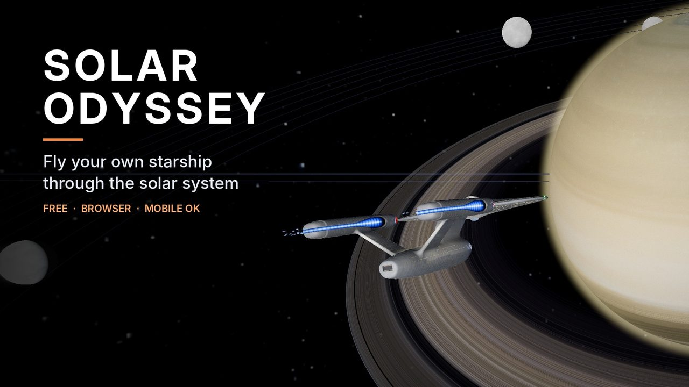](https://junzzy827.github.io/solar-odyssey/?lang=en)

## Screenshots

### Travel the Solar System

| | |
| --- | --- |
| 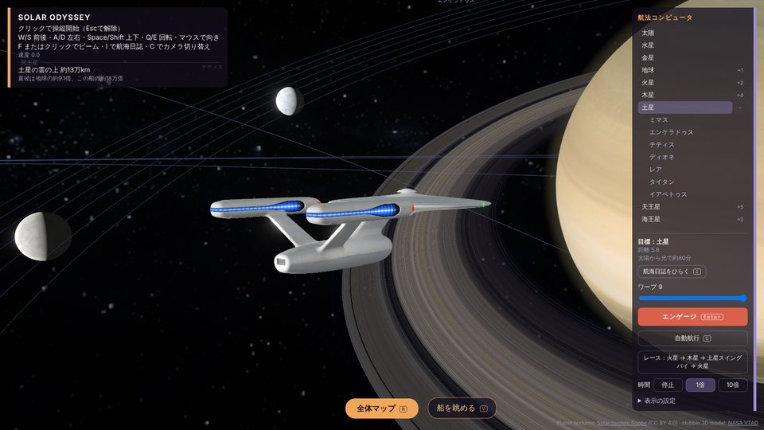 | 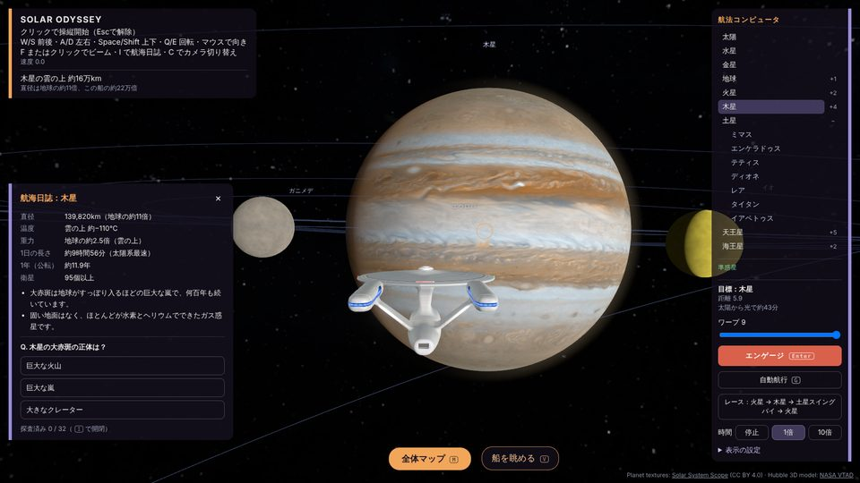 |
| Warp to any planet or moon and fly freely | Read the ship's log for each world and try the quiz |
| 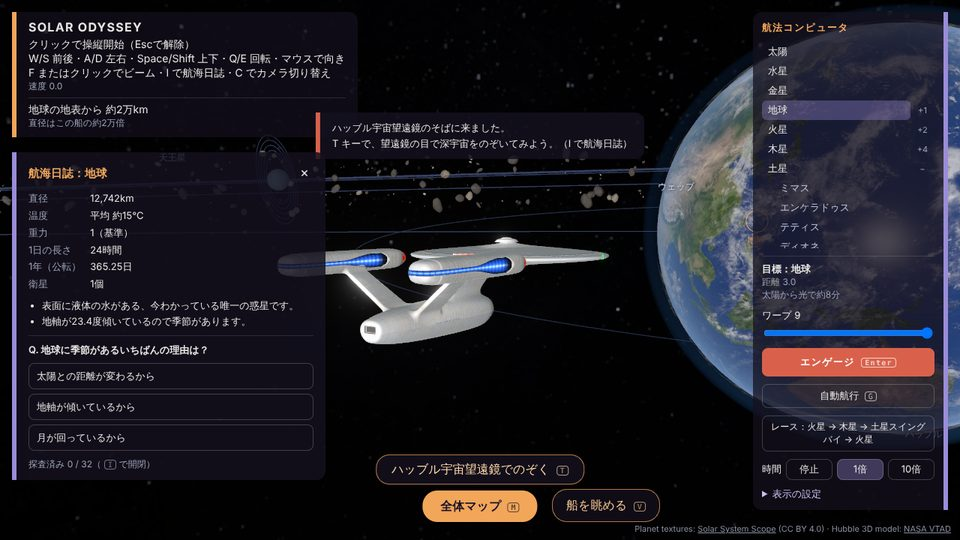 | 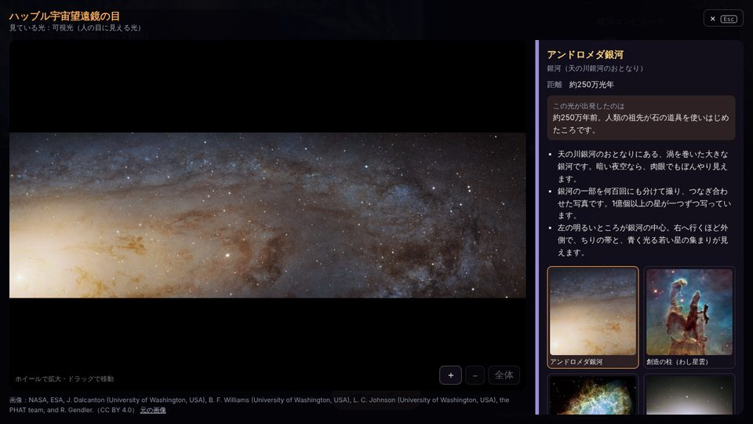 |
| Facts based on real data | Telescope mode shows real Hubble images |

### Ships and bridge

| | |
| --- | --- |
| 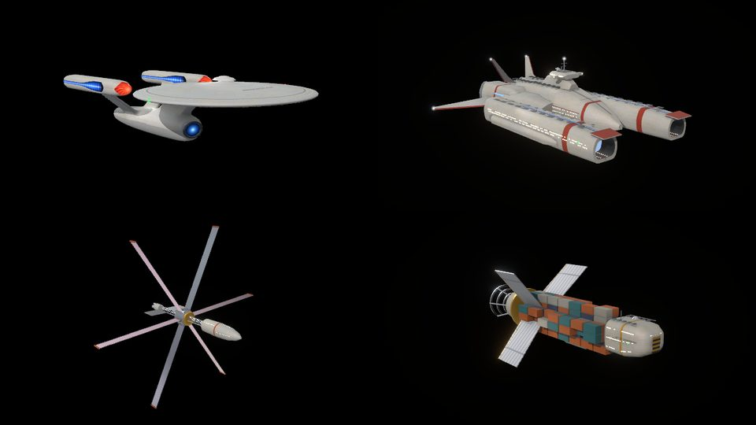 | 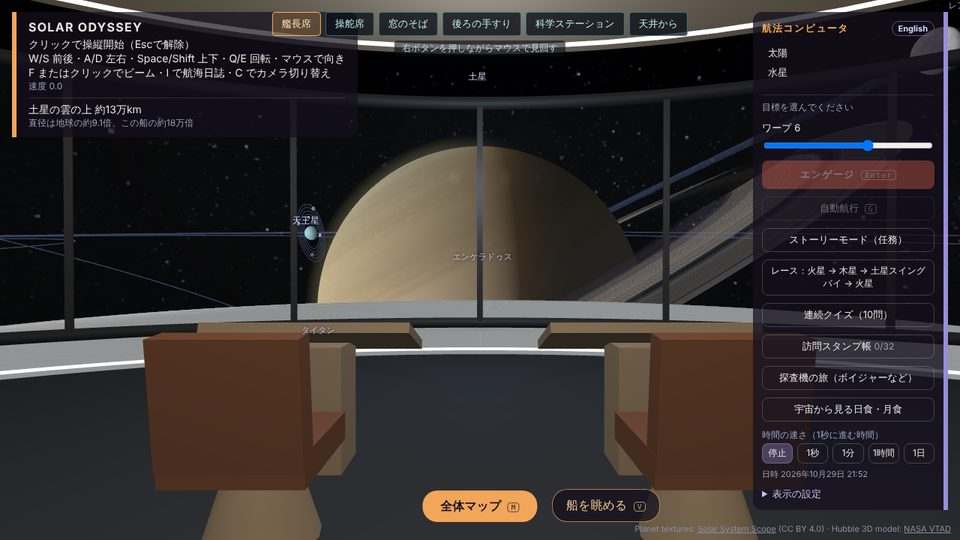 |
| Choose from a fleet of original starships | Step onto the bridge and look out the window |

### SF mode

| | |
| --- | --- |
| 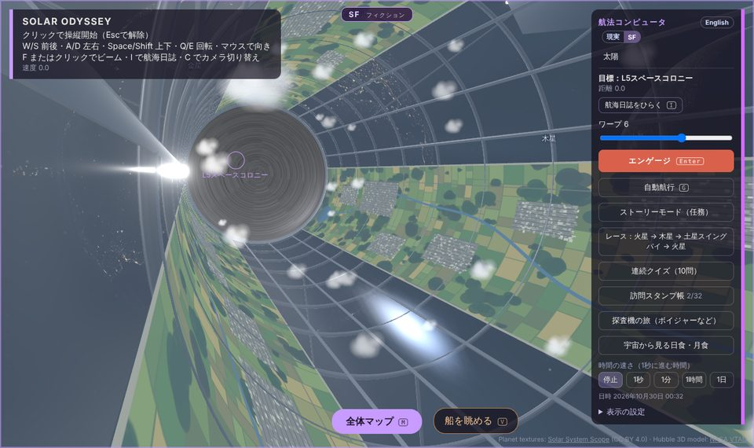 | 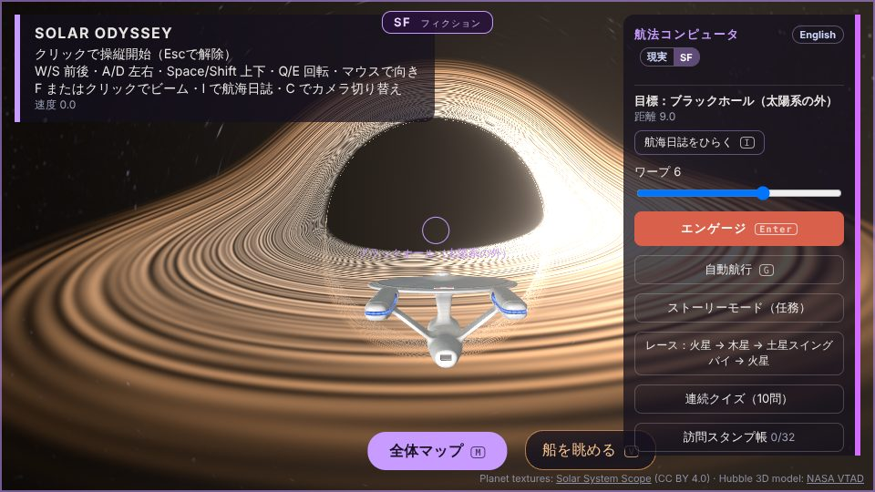 |
| A rotating cylinder space colony | A black hole beyond the Solar System |
| 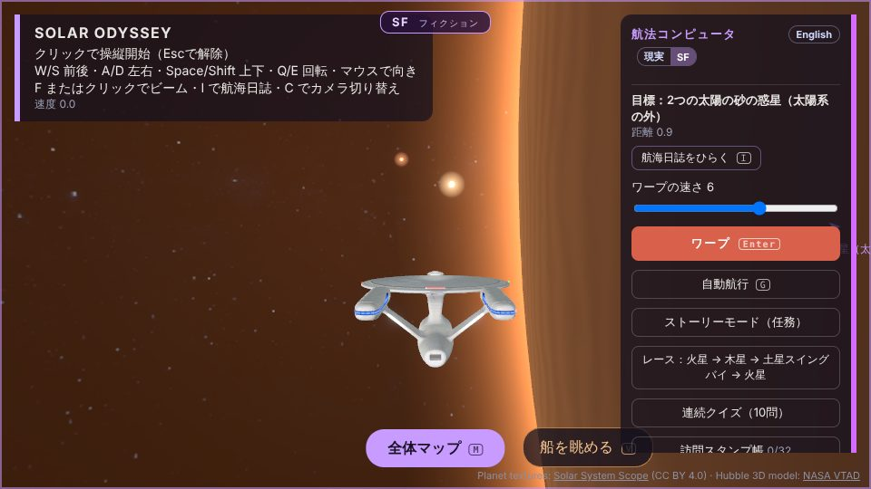 | 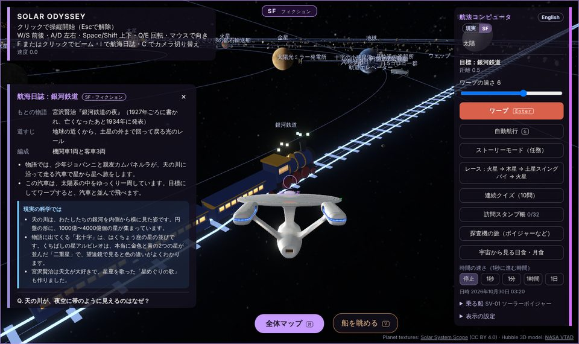 |
| A desert planet with two setting suns | A galactic railway running through space |

### On your phone

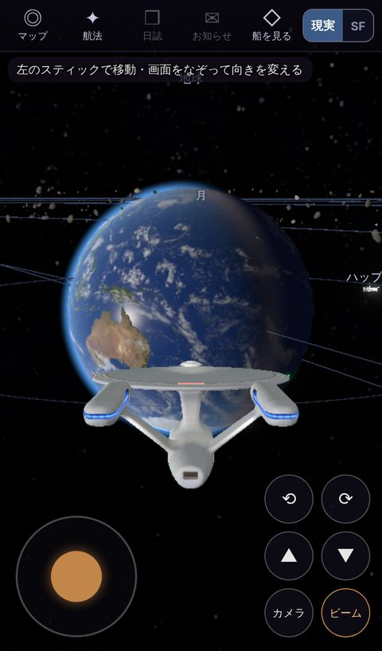

## Features

- **Real Solar System:** planets sit at their real positions for today's date, with data from the NASA Planetary Fact Sheet. Real star catalog background and probe journeys (Voyager, Cassini, New Horizons, Hayabusa2).
- **Free flight:** WASD + mouse, warp to any target, autopilot, overview map, bridge view and observation mode.
- **Seven original ships** to choose from, from a small survey vessel to a 1,200 m mobile carrier.
- **Landing:** take the lander down to 27 planets and moons, with weather, day/night and real Mars and Earth terrain.
- **Rover:** drive the ORV-7 rover, collect rock samples and fill a rock collection book.
- **EVA robot:** fly a work robot outside the ship and do repair missions.
- **Learning:** ship's log for each body, quizzes, a visit stamp book and titles, story mode.
- **SF mode:** space colonies, an orbital space dock, asteroid bases, black holes and more.

## Controls

| Action | Key |
| --- | --- |
| Toggle overview map / cockpit | M |
| Start flying (lock mouse) / release | Click the screen / Esc |
| Forward/back, left/right, up/down | W/S, A/D, Space/Shift |
| Look, roll | Mouse, Q/E |
| Set a target | Navigation panel on the right, or click a name on the map |
| Warp speed | 1–9 |
| Warp | Enter |
| Autopilot | G |
| View your ship (viewing mode) | V |

On phones and tablets, use the stick at the bottom left to move, drag the screen to look around, and the buttons at the bottom right to rise, sink, roll and fire the beam.

## Development

```bash
npm install
npm run dev      # http://localhost:5173
npm run build    # output in dist/
```

### Tech

- Vite + TypeScript + React Three Fiber (Three.js)
- `src/data/bodies.ts` body data (rounded values from the NASA Planetary Fact Sheet)
- `src/data/scale.ts` display scale. Distances are compressed logarithmically, and planets orbit on concentric rings in one plane
- `src/i18n/lang.ts` Japanese/English switch. UI text is written as `t('日本語', 'English')`
- `public/models/ship-hull.glb` the main ship's engineering hull, generated by `tools/blender/build_hull.py`
  (uses Blender's Python module; run with Python 3.13 after `pip install bpy scikit-image`).
  Open with `#hangar` to view only the ship (`#hangar?cam=x,y,z&target=x,y,z&fov=n` fixes the camera)

### Deploy

Pushing to `main` deploys to GitHub Pages through GitHub Actions.
The first time only, set Settings → Pages → Source to "GitHub Actions".

## About the designs

This app does not use names, logos, artwork or audio from any existing franchise. The ships and screen designs are original.
The background music (`public/music/`) was also written for this app and is synthesized by `tools/music/bgm.py`.
